I'm Hussein. I build software that reads raw data and explains what it finds, from the fault codes in a car's computer to the pixels a vision model is actually paying attention to.

I like problems where the answer has to be trusted, so my tools show their work.

## Live data

  
  

## Clear codes

Always up for talking cars, computer vision, or anything that needs debugging.

[LinkedIn](https://www.linkedin.com/in/hussein-haidar-ahmad)
